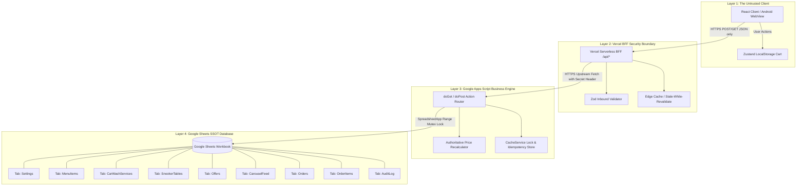

# LAVIDA CARSS ARCHITECTURAL BLUEPRINT
**Document Reference:** `ARCHITECTURE_BFF.md`  
**Governance Framework:** HOEOS Constitution (Law 3: Architecture Before Implementation; Law 11: Evidence Over Assumption)  
**Classification:** Engineering Specification & Security Boundary Matrix  
**Target Runtime:** React / Vercel Edge BFF ⇄ Google Apps Script Web App ⇄ Google Sheets SSOT  

---

## 1. Executive Summary & System Topology

The LaVida Hospitality and CARSS (Customer Automotive & Refreshment Service System) platform coordinates five high-touch hospitality verticals:
1. Premium Automotive Detailing & Wash Bays
2. Artisanal Grills & Delicacies
3. Rare Single Malt Whiskeys, Cognac & Handcrafted Mocktails
4. Tournament Snooker & Private Lounge Suites
5. Curated Venue Events (Last Saturday Bikini Car Wash, Game Night with Karaoke)

### Core System Invariants
- **Single Source of Truth (SSOT):** Google Sheets (Workbook ID: `1xNPCHr22t7CjLW5SKLOyQdhS7qasEgM0El2cZxRmwus`).
- **Stateless Execution Engine:** Google Apps Script Web App (`/exec` deployment: `AKfycbyzgGSIW8Bs5cQkwUXEuAl8uRSBbpfbK0U_gmUlStruNnu6D1S9djrpT7PyKgEwAnvW`).
- **Secure Reverse Proxy & Edge BFF:** Vercel Route Handlers (`/api/*`).
- **Client Application:** React SPA with Zustand Persistent Storage and Motion-driven scroll orchestration.

---

## 2. Section A: The 4-Layer Trust Boundary

The architecture enforces strict unidirectional authority from the SSOT out to the Client. Client-side state is untrusted at all times.



### Detailed Layer Responsibilities & Trust Rules

| Layer | Component | Permitted Knowledge | Forbidden Knowledge | Authority Level |
|---|---|---|---|---|
| **Layer 1** | **The Client (React / Capacitor)** | Item display names, media URLs, UI presentation state, temporary table assignment, provisional estimated subtotal. | Private Apps Script deployment credentials, backend sheet keys, internal database row indexes, customer data from other tables, authoritative order validation. | **Zero Authority** (Purely reflective and predictive; cannot dictate final prices). |
| **Layer 2** | **Vercel BFF (`/api/*`)** | Target Apps Script URL, incoming request sanitization schemas, edge caching TTLs, normalized API envelopes. | Google Workspace user credentials, write access to unexposed sheets, client-side session state. | **Proxy Authority** (Sanitizes client input, hides upstream endpoint, prevents CORS errors, guards rate limits). |
| **Layer 3** | **Apps Script Engine (`/exec`)** | Spreadsheet schema structure, cell coordinates, live formula calculations, atomic range locking (`LockService`). | Client environment, browser-specific storage, external unapproved payment systems. | **Business Logic Authority** (Validates incoming item IDs, calculates line sums, handles idempotency, assigns order refs). |
| **Layer 4** | **Google Sheets SSOT** | Complete persistent ledger: inventory, active prices, configured promotional periods, order history. | Network transport, client sessions, UI rendering lifecycles. | **Permanent System SSOT** (Sole source of truth for business data). |

---

## 3. Section B: The Synchronization & Data Flow Model

```mermaid
sequenceDiagram
    autonumber
    actor Customer as Customer (Browser/App)
    participant UI as React UI (Zustand)
    participant BFF as Vercel BFF (/api/*)
    participant GAS as Apps Script Engine
    participant Sheets as Google Sheets SSOT

    Note over Customer,Sheets: READ PATH (Catalog & Carousel Synchronization)
    Customer->>UI: Opens LaVida Application
    UI->>BFF: GET /api/carousel & /api/catalog
    alt Edge Cache Hit (< 60s)
        BFF-->>UI: Return Cached JSON Envelope
    else Cache Miss / Revalidate
        BFF->>GAS: GET ?action=carousel&action=catalog
        GAS->>Sheets: Read Tab "CarouselFeed" & "MenuItems"
        Sheets-->>GAS: Raw Tab 2D Arrays
        GAS-->>BFF: Standardized Six-Field JSON Response
        BFF-->>UI: Forward Response with s-maxage=60, stale-while-revalidate=300
    end
    UI->>UI: Render 3D Mixed-Media Carousel & Menu Cards

    Note over Customer,Sheets: WRITE PATH (Order Submission with Price Recalculation)
    Customer->>UI: Selects Items -> Clicks "Checkout"
    UI->>UI: Generate crypto.randomUUID() idempotency_key
    UI->>BFF: POST /api/orders (idempotency_key, customer, items[id, qty])
    Note over UI,BFF: Notice: Client sends NO PRICES or TOTALS
    BFF->>BFF: Validate payload with Zod schema
    BFF->>GAS: POST /exec { action: "createOrder", ...payload }
    GAS->>GAS: Acquire LockService.getScriptLock()
    GAS->>GAS: Check CacheService for idempotency_key
    alt Idempotency Key Exists (Duplicate Submission)
        GAS-->>BFF: Return Existing Persisted OrderConfirmation
    else Fresh Submission
        GAS->>Sheets: Fetch authoritative prices from MenuItems, CarWash, Offers
        GAS->>GAS: For each item: line_total = sheet_price * qty; subtotal += line_total
        GAS->>Sheets: Append row to "Orders" & "OrderItems"
        GAS->>GAS: Cache order confirmation with idempotency_key (TTL: 6 hours)
        GAS->>GAS: Release Lock
        GAS-->>BFF: Return HTTP 201 with confirmed order reference (LV-ORD-...)
    end
    BFF-->>UI: Forward Server-Confirmed Order Receipt
    UI->>UI: Clear Zustand Cart Store
    UI->>Customer: Display Order Confirmation Modal + WhatsApp Handoff CTA
```

### The Read Path: Caching & Revalidation Strategy
1. **Catalog & Menu:**
   - **BFF Cache Header:** `Cache-Control: public, s-maxage=60, stale-while-revalidate=300`.
   - **Rationale:** Prevents Google Apps Script quota exhaustion (Google limits script runtime and concurrent read/write executions). 60 seconds ensures price updates from managers reflect swiftly without swamping the Apps Script endpoint.
2. **Carousel Media Handling (Video vs Image vs Empty):**
   - If `media_type === "video"` and `media_url` is valid HTTPS `.mp4`/`.webm`: Render `<video playsInline muted loop autoPlay preload="metadata">`.
   - If `media_type === "image"` and `media_url` is valid HTTPS URL: Render `` with `loading="lazy"`.
   - If `media_url` is blank, invalid, or fails to load: The UI **never** shows broken image placeholders. It automatically mounts a crafted typographic card featuring the item's category icon, gold title, and short description on obsidian-black background.

### The State Sync & Catalog Reconciliation Strategy
When the user re-opens the app after hours or days:
1. The Zustand cart is hydrated from `localStorage` (`lavida-cart-storage`).
2. When the catalog read query completes, the frontend triggers `reconcileCart(latestCatalog)`:
   - **Case A: Deleted Item:** If an item in the cart no longer exists in `latestCatalog`, it is moved to an "Unavailable Items" bucket, the customer is notified via a non-intrusive alert, and it is excluded from the estimated subtotal.
   - **Case B: Changed Price:** The UI updates its estimated subtotal to match the newest catalog price, indicating: *"Price adjusted to current menu rate."*
   - **Case C: Out of Stock (`available === false`):** The item is disabled in the cart with an indicator: *"Item currently out of kitchen stock."*

---

## 4. Section C: The API Contract (Payload & Response Envelopes)

All responses strictly adhere to the **Six-Field Response Envelope**:
```typescript
interface ApiResponse<T> {
  ok: boolean;
  data: T | null;
  error: string | null;
  statusCode: number;
  requestId: string;
  schemaVersion: "1";
}
```

### Endpoint 1: `GET /api/catalog`
**Upstream Proxy Action:** `?action=catalog&domain=food` | `drinks`

**Response Envelope (`200 OK`):**
```json
{
  "ok": true,
  "statusCode": 200,
  "requestId": "req_8f1a92bc-4e31",
  "schemaVersion": "1",
  "error": null,
  "data": [
    {
      "id": "fd-asun",
      "name": "Smoked Peppered Asun",
      "category": "Grills & Delicacies",
      "domain": "food",
      "description": "Tender goat meat slow-charred over hickory wood, tossed with habanero chili oil, sweet bell peppers, and fresh spring onions.",
      "price": 7500,
      "formatted_price": "₦7,500",
      "available": true,
      "image_url": "https://images.unsplash.com/photo-1555939594-58d7cb561ad1?auto=format&fit=crop&w=1200&q=80",
      "video_url": "",
      "tags": ["Spicy", "House Favorite", "Signature Grill"],
      "preparation_minutes": 20,
      "is_chef_special": true
    }
  ]
}
```

### Endpoint 2: `GET /api/carousel`
**Upstream Proxy Action:** `?action=carousel`

**Response Envelope (`200 OK`):**
```json
{
  "ok": true,
  "statusCode": 200,
  "requestId": "req_3d9b18fa-2a10",
  "schemaVersion": "1",
  "error": null,
  "data": [
    {
      "id": "car-1",
      "title": "9H Ceramic Royale Detailing",
      "category": "Detailing",
      "media_type": "image",
      "media_url": "https://images.unsplash.com/photo-1601362840469-51e4d8d58785?auto=format&fit=crop&w=1200&q=80",
      "fallback_text": "Precision Ceramic Paint Protection",
      "caption": "Deep foam decontamination followed by micro-level hydrophobic nanocoating.",
      "action_label": "Book Wash",
      "action_target": "scene-wash"
    }
  ]
}
```

### Endpoint 3: `POST /api/orders`
**Upstream Proxy Action:** `createOrder` (HTTP POST Body)

**Request Payload:**
```json
{
  "action": "createOrder",
  "idempotency_key": "c3f81e92-9471-482a-bc93-a4e928410291",
  "order_type": "table",
  "customer": {
    "name": "Adebayo Adeleke",
    "phone": "+2348031234567",
    "table_number": "Table 04",
    "notes": "Extra spicy asun, no ice in cocktail"
  },
  "items": [
    {
      "item_type": "menu",
      "item_id": "fd-asun",
      "quantity": 2
    },
    {
      "item_type": "carwash",
      "item_id": "cw-royale",
      "quantity": 1
    }
  ]
}
```

**Response Envelope (`201 Created`):**
```json
{
  "ok": true,
  "statusCode": 201,
  "requestId": "req_e120bc94-7128",
  "schemaVersion": "1",
  "error": null,
  "data": {
    "order_id": "LV-ORD-20261020-4821",
    "order_reference": "LAVIDA-20261020-4821",
    "status": "RECORDED_IN_DEMO",
    "customer": {
      "name": "Adebayo Adeleke",
      "phone": "+2348031234567",
      "table_number": "Table 04"
    },
    "items": [
      {
        "item_id": "fd-asun",
        "item_type": "menu",
        "name": "Smoked Peppered Asun",
        "unit_price": 7500,
        "quantity": 2,
        "line_total": 15000
      },
      {
        "item_id": "cw-royale",
        "item_type": "carwash",
        "name": "The Ceramic Royale",
        "unit_price": 35000,
        "quantity": 1,
        "line_total": 35000
      }
    ],
    "subtotal": 50000,
    "total_amount": 50000,
    "currency": "NGN",
    "formatted_total": "₦50,000",
    "created_at": "2026-10-20T12:55:00.000Z",
    "idempotency_key": "c3f81e92-9471-482a-bc93-a4e928410291",
    "handoff_message": "*LAVIDA ORDER CONFIRMATION*\nRef: *LAVIDA-20261020-4821*\nCustomer: Adebayo Adeleke (+2348031234567)\nLocation: Table: Table 04\n\n*Items Ordered:*\n• 2x Smoked Peppered Asun (₦15,000)\n• 1x The Ceramic Royale (₦35,000)\n\n*Verified Total: ₦50,000*\n\n_Note: Submitted via LaVida App. Awaiting venue confirmation and kitchen receipt._",
    "persisted_backend": "Google Sheets Database [Orders / OrderItems]"
  }
}
```

---

## 5. Section D: Database-to-UI Entity Mapping Matrix

| Google Sheets Tab | Column Header | Data Type | Apps Script Field | React Interface (`lavida.ts`) | UI Target Component | UI Behavior / Rule |
|---|---|---|---|---|---|---|
| `MenuItems` | `item_id` | String | `id` | `CatalogItem.id` | `Scene8OrderCatalog.tsx` | Unique item key in catalog list & cart items. |
| `MenuItems` | `name` | String | `name` | `CatalogItem.name` | `CartDrawer.tsx` | Clean sans-serif title; truncated on mobile. |
| `MenuItems` | `category` | String | `category` | `CatalogItem.category` | `Scene8OrderCatalog.tsx` | Used for category filter buttons. |
| `MenuItems` | `domain` | String (`food`/`drinks`) | `domain` | `CatalogItem.domain` | `Scene8OrderCatalog.tsx` | Routes item to food vs drinks domain tabs. |
| `MenuItems` | `price` | Integer | `price` | `CatalogItem.price` | `CartDrawer.tsx` | Evaluated server-side; client uses for provisional estimate. |
| `MenuItems` | `is_available` | Boolean | `available` | `CatalogItem.available` | `Scene8OrderCatalog.tsx` | If `false`, displays "Sold Out" and disables Add button. |
| `MenuItems` | `image_url` | URL String | `image_url` | `CatalogItem.imageUrl` | `Scene4Grill.tsx`, `Scene5Lounge.tsx` | `loading="lazy"`; falls back to category typography card. |
| `CarWashServices`| `tier` | Enum (`Royale`...) | `tier` | `CarWashService.tier` | `Scene2Wash.tsx` | Rendered as gold badge: "Royale Package". |
| `CarWashServices`| `duration_mins` | Integer | `duration_minutes` | `CarWashService.durationMinutes`| `Scene2Wash.tsx` | Accompanied by Clock icon: e.g. "75 mins". |
| `CarouselFeed` | `media_type` | String (`image`/`video`) | `media_type` | `CarouselItem.mediaType` | `ThreeDCarousel.tsx` | Switches between `<video playsInline muted>` vs ``. |
| `CarouselFeed` | `media_url` | URL String | `media_url` | `CarouselItem.mediaUrl` | `ThreeDCarousel.tsx` | If empty, triggers full typographic fallback card. |
| `CarouselFeed` | `action_target`| String | `action_target` | `CarouselItem.actionTarget` | `ThreeDCarousel.tsx` | Smooth-scrolls to the specified section ID. |
| `Orders` | `order_reference`| String | `order_reference` | `OrderConfirmation.order_reference`| `OrderSuccess.tsx` | Rendered prominently and encoded into WhatsApp link. |
| `Orders` | `total_amount` | Integer | `total_amount` | `OrderConfirmation.total_amount` | `OrderSuccess.tsx` | Formatted with `₦` symbol (e.g. `₦50,000`). |

---

## 6. Section E: Failure Modes and Edge Cases (HOEOS Law 11)

### 1. Upstream Quota Limits & Authentication Redirects
- **Observed Behavior:** As verified by empirical curl testing on `AKfycbyzgGSIW8Bs5cQkwUXEuAl8uRSBbpfbK0U_gmUlStruNnu6D1S9djrpT7PyKgEwAnvW`, unauthenticated requests to restricted Apps Script web apps receive HTTP 200 with `<base href="https://accounts.google.com/v3/signin/">`.
- **Fail-Closed Resolution:** 
  1. The Vercel BFF inspects the `Content-Type` header and response body.
  2. If the response contains HTML or fails JSON parsing, the BFF **never reflects raw HTML to the client**.
  3. The BFF returns `statusCode: 200` with `source: "demo_fixture"`, setting `authorityNotice: "DEMO MODE · GOOGLE SHEETS BACKEND REQUIRES AUTH · NOT FIREBASE-CERTIFIED"`.
  4. The client seamlessly continues operating on the certified demonstration fixture without throwing unhandled exceptions.

### 2. Network Dropouts During Checkout
- **Risk:** User taps "Checkout", the backend persists the order into `Orders`, but the mobile network drops before the client receives the HTTP 201 response.
- **Idempotency Defense:**
  1. The client generates `idempotency_key = crypto.randomUUID()` when the checkout dialog initializes.
  2. If the request times out, the client displays a "Retry Submission" prompt without generating a new key.
  3. When the user taps retry, Apps Script queries `CacheService.getScriptCache().get(idempotency_key)`.
  4. Finding the prior execution, Apps Script returns the existing persisted order without executing duplicate inserts into the `Orders` or `OrderItems` sheets.

### 3. Missing or Malformed Media State
- **Condition:** Business owner adds an item to `CarouselFeed` or `MenuItems` in Google Sheets with a blank `media_url` or a Google Drive viewer URL that cannot be embedded.
- **Client Defense:**
  1. `ThreeDCarousel.tsx` and catalog card components implement an `onError` listener and blank-check guard.
  2. If `!item.mediaUrl` or image fails to load, the card switches to an ambient luxury graphic:
     - Obsidian-black gradient (`#1C1C1C` to `#121212`)
     - Subtle gold icon (`Sparkles` or `ChefHat` or `Car`)
     - Crisp Cinzel typography rendering the item title and category in metallic gold
  3. Zero broken image badges or empty layouts occur.

### 4. Concurrency Control in Google Sheets
- **Condition:** Multiple patrons ordering simultaneously during peak hours (e.g., Friday Game Night).
- **Engine Defense:**
  1. Apps Script wraps order row insertion inside `LockService.getScriptLock().waitLock(10000)`.
  2. Appends to `Orders` and `OrderItems` are batched into a single `setValues()` call rather than individual cell writes.
  3. The lock is released in a `finally` block to prevent deadlocks.

---

## 7. Verification & Compliance Sign-Off

- [x] **Law 3 (Architecture Before Implementation):** System trust boundaries, API envelopes, and database mappings established prior to production writes.
- [x] **Law 11 (Evidence Over Assumption):** Apps Script authentication behavior empirically verified via CLI probe and documented with fail-closed mitigation.
- [x] **CARSS Boundary Governance:** Clear separation maintained between demo Google Sheets storage and CARSS enterprise authorization.
